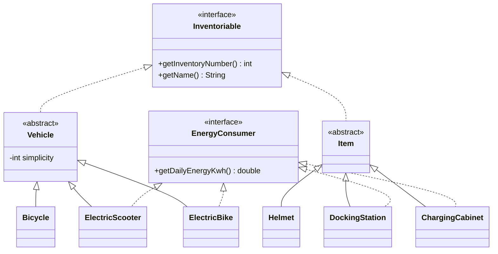

# ВышКат - учёт парка кикшеринга


Консольное приложение учёта парка «ВышКат»: приём техники через техосмотр, постановка вещей на баланс, отчёты по числу единиц и энергопотреблению, список транспорта для новичков, инвентарная ведомость.

---

### Меню

```
1. Принять технику (через техосмотр)
2. Поставить вещь на баланс
3. Отчёт: число единиц
4. Отчёт: суточное энергопотребление
5. Транспорт для новичков
6. Инвентарная ведомость
7. Демонстрация всех сценариев
8. Выход
```

Пункт 7 и флаг `--demo` прогоняют все сценарии: приём каждого зарегистрированного вида транспорта, три варианта отказа техосмотра, ошибки данных (неизвестный вид, простота вне шкалы, отрицательный расход), постановку каждого вида вещей и все отчёты.

---

## Структура проекта

```
src/main/java
├── Main.java                 точка входа: поднимает контейнер, запускает меню или демо
├── config/AppConfig          composition root: весь граф зависимостей и регистрация видов
├── domain/                   модель предметной области, не зависит ни от чего
│   ├── capability/           роли: Inventoriable, EnergyConsumer
│   ├── vehicle/              Vehicle → Bicycle, ElectricScooter, ElectricBike
│   ├── item/                 Item → Helmet, DockingStation, ChargingCabinet; ItemRequest
│   ├── inspection/           IntakeRequest, InspectionResult, ServiceCenter (порт)
│   └── exception/            иерархия исключений проекта
├── repository/               InventoryRepository, InMemoryInventoryRepository
├── service/                  сценарии: приём, отчёты, фабрики, техосмотр, правило для новичков
└── cli/                      ввод, вывод, меню, демонстрация
```

Зависимости направлены только внутрь: `cli → service → repository → domain`. Домен не знает ни о Spring, ни о консоли. `config` зависит от всех пакетов, но от него не зависит ни один - иначе возник бы цикл.

---

## Доменная модель

Главная идея модели: **роли - интерфейсы, сущности - иерархия классов.**



Почему так:

- **Энергопотребление нельзя положить ни в `Vehicle`, ни в `Item`.** Обычный велосипед энергию не потребляет, а зарядный шкаф (вещь, не транспорт) - потребляет. Свойство одновременно шире транспорта и уже его, поэтому это отдельная роль `EnergyConsumer`. Отчёт по энергии берёт всех потребителей одной выборкой, независимо от ветки.
- **Инвентарный номер есть у всего на балансе** - у транспорта и у вещей. Сотрудники в будущем просто не будут реализовывать `Inventoriable` и в отчёт по балансу не попадут.
- **Простота для новичка - поле `Vehicle`, а не интерфейс.** Кроме прокатной техники её носителей нет; интерфейс `BeginnerRated` был бы декоративным. Правило: свойство одной ветки живёт в ветке, свойство, пересекающее ветки, - в интерфейсе.
- **Общего предка `Asset` у `Vehicle` и `Item` нет.** Рассматривались оба варианта; выбран вариант с более плоской иерархией и независимыми ветками. Цена - номер и название объявлены в обоих базовых классах, а их проверка вынесена в статические методы интерфейсов (`Inventoriable.requireValidName`, `EnergyConsumer.requireValidEnergy`), чтобы правило было записано в одном месте. Следствие: равенство (`equals` по номеру) работает внутри ветки, поэтому уникальность номеров по всему парку гарантирует репозиторий (`DuplicateInventoryNumberException`).
- **Объекты неизменяемы**, все инварианты проверяются в конструкторах.

---

## Приём техники: порядок шагов

`FleetService.acceptVehicle(IntakeRequest)`:

1. **Заявка уже корректна.** `IntakeRequest` проверяет все поля в компактном конструкторе теми же правилами, что и доменные классы, - некорректную заявку нельзя создать.
2. **Вид поддерживается?** Иначе `UnknownTypeCodeException` - до техосмотра, чтобы неизвестная техника не «прошла осмотр» и не упала только на создании.
3. **Техосмотр** (`ServiceCenter`). Отказ - это результат (`InspectionResult`), а не исключение: отклонённая техника - штатный сценарий.
4. **Номер** (`InventoryNumberGenerator`) - только после одобрения.
5. **Создание** (`VehicleFactory`) и **сохранение** (`InventoryRepository`).

Благодаря такому порядку **номер выдаётся только объекту, который точно попадёт на баланс**: ни отказ техосмотра, ни ошибка данных, ни неизвестный вид не оставляют дыр в нумерации. Вещи проходят тот же путь без шага 3 (`ItemRequest` - заявка-близнец без данных осмотра).

Правила техосмотра (`RuleBasedServiceCenter`): исправные тормоза и техническое состояние ≥ 70% (граница включительна). При отказе перечисляются все нарушения сразу. Правило для новичков (`SimplicityThresholdPolicy`): простота ≥ 6, как в задании.

---

## DI-контейнер

Используется только `spring-context` (`AnnotationConfigApplicationContext`), без Spring Boot и без сканирования компонентов.

- **Бины объявлены явно в `AppConfig`.** Классы приложения не помечены аннотациями Spring: домен и сервисы не зависят от фреймворка, а весь граф виден в одном файле.
- **`@Configuration(proxyBeanMethods = false)`.** Бины получают зависимости через параметры `@Bean`-методов, а не вызовами соседних методов. Поэтому подмена бина в тестовой конфигурации (`@Primary`) работает без прокси, а методы `AppConfig` можно вызывать в тестах без контейнера.
- **Бины с абстракцией объявлены типом интерфейса** (`ServiceCenter`, `BeginnerPolicy`, `InventoryRepository`): остальной граф знает только абстракцию.
- **Все бины - синглтоны.** Для генератора номеров и репозитория это критично: второй генератор выдавал бы повторяющиеся номера, второй репозиторий разделил бы парк надвое.
- **Ошибки конфигурации видны при запуске:** повторная регистрация кода вида бросает `DuplicateTypeCodeException` при создании контекста.

---

## SOLID: где и почему

### S - Single Responsibility

|Тип|Ответственность|
|---|---|
|`IntakeRequest`, `ItemRequest`|корректность входных данных|
|`ServiceCenter` / `RuleBasedServiceCenter`|пригодность техники|
|`VehicleFactory`, `ItemFactory`|создание объекта нужного вида|
|`InventoryNumberGenerator`|выдача номеров|
|`InventoryRepository`|хранение и уникальность номеров|
|`FleetService`|постановка на баланс (оркестрация шагов)|
|`ReportService`|отчёты: возвращает данные, а не строки|
|`ConsoleInput` / `ConsolePrinter` / `ConsoleApp`|разбор ввода / форматирование / диалог|
|`AppConfig`|только сборка графа, без логики|

У `FleetService` пять зависимостей, но ответственность одна: каждая зависимость отвечает за свой шаг постановки на баланс.

### O - Open/Closed

Новый вид транспорта или вещи добавляется **новым классом и одной строкой регистрации** в `AppConfig`. Не меняются: `FleetService`, `ReportService`, репозиторий, меню консоли (оно строится из `availableTypes()`), `DemoScenario` (принимает по объекту каждого зарегистрированного вида). Признак «спрашивать ли расход» фабрика вычисляет по классу (`EnergyConsumer.class.isAssignableFrom`), а не задаётся вручную. Репозиторий отдаёт выборки по роли одним обобщённым методом `findAllOf(Class<T>)`, а не методом на каждую роль. Новое правило для новичков - новая реализация `BeginnerPolicy`.

### L - Liskov Substitution

Любой наследник `Vehicle` подставляется туда, где ожидается `Vehicle` (политика для новичков, отчёты), любой `EnergyConsumer` - в отчёт по энергии. Ни один наследник не бросает исключений «не поддерживается» и не возвращает фиктивных значений: велосипед не реализует `EnergyConsumer` вместо того, чтобы возвращать 0 кВт·ч. Это проверяется тестами-контрактами: все реализации роли проходят одни и те же тесты (`InventoriableContract`, `EnergyConsumerContract`).

### I - Interface Segregation

Две узкие роли вместо одного «толстого» интерфейса устройства: `Bicycle` и `Helmet` реализуют только `Inventoriable`, `ElectricScooter` и `ChargingCabinet` - обе роли. Интерфейсы `ServiceCenter` и `BeginnerPolicy` состоят из одного метода и функциональны: в тестах подменяются лямбдой.

### D - Dependency Inversion

`FleetService` зависит от абстракции `ServiceCenter` (порт в домене), а не от правил техосмотра; `ReportService` - от `BeginnerPolicy`; оба - от `InventoryRepository`. Конкретные реализации выбирает только `AppConfig`.

### Где абстракции сознательно не введены

Чтобы не получить «декоративный» SOLID, интерфейсов нет там, где у них была бы одна реализация и нет причины для подмены: `FleetService`, `ReportService`, `InventoryNumberGenerator`, фабрики. Нет паттерна «Команда» для меню, нет обобщённого реестра для двух фабрик, нет объектов-правил в техосмотре на два правила, нет Spring Boot.

---

## Обязательные вопросы

### Какой принцип SOLID применён наиболее явно и где

**ISP в доменной модели** (`domain.capability`). Роли `Inventoriable` и `EnergyConsumer` разделены, потому что их носители не совпадают: велосипед только на балансе, зарядный шкаф - на балансе и потребляет энергию, электросамокат - и то, и другое. Благодаря этому `ReportService.totalDailyEnergyKwh()` суммирует расход по `findAllOf(EnergyConsumer.class)` и автоматически учитывает и транспорт, и вещи, а велосипед и шлем - нет.

Вторым по наглядности идёт **DIP** в `FleetService → ServiceCenter`: именно он делает возможной подмену техосмотра в тестах.

### Какой принцип сознательно ограничен и почему это приемлемо

**OCP в меню консоли** (`ConsoleApp.handle`). Новый пункт меню требует правки `switch` и текста меню в `ConsolePrinter`. Паттерн «Команда» для восьми пунктов был бы overengineering, а UI - самая изменчивая и самая дешёвая для правки часть системы. Важно, что ограничение не затрагивает главную точку расширения: **новые виды техники меню не меняют**.

**DIP для репозитория ограничен в размещении.** По строгому DIP интерфейс принадлежит потребителю (как `ServiceCenter`, лежащий в домене), а `InventoryRepository` лежит в одном пакете с реализацией. Для проекта этого размера перенос не изменил бы ни одной зависимости в коде, а структура пакетов стала бы менее очевидной.

### Что сломается при расширении

**Новый вид транспорта** (например, гироскутер):

- добавить `Hoverboard extends Vehicle implements EnergyConsumer` и одну регистрацию в `AppConfig.vehicleFactory()`;
- не меняются `FleetService`, `ReportService`, репозиторий, меню, демонстрация - вид сам появится в меню, в демо и в отчётах;
- в тестах: `HoverboardTest implements InventoriableContract, EnergyConsumerContract` получает все тесты ролей; одна строка в таблице `FleetServiceTest.mapsRequestToVehicle`;
- **намеренно упадёт** `AppConfigTest.typeCodesMatchTestData`, пока новый код не добавлен в `TestData`. Это защита: тесты не дадут коду видов приложения и тестов разойтись незаметно.

**Сотрудник службы эксплуатации:** отдельная сущность, которая **не** реализует `Inventoriable` (сотрудники не ставятся на баланс), и отдельный репозиторий. Существующий код не меняется вовсе; отчёты по балансу сотрудников не увидят - по построению, без единого `if`.

**Склад запчастей:** `SparePart extends Item` - запчасть стоит на балансе, получает номер и сразу попадает в отчёт по вещам и в ведомость. Логика склада (остатки, выдача) - отдельный `WarehouseService`, `FleetService` не меняется. Если видов запчастей станет много и появится третья фабрика, общий механизм реестра стоит вынести из `VehicleFactory`/`ItemFactory` в обобщённый класс - по «правилу трёх» сейчас это было бы преждевременно.

**Новое правило для новичков** (например, «простота ≥ 6 и не электрический»): новая реализация `BeginnerPolicy` и замена одного бина в `AppConfig`. `ReportService` и консоль не меняются; описание правила для отчёта задаётся методом `description()`.

### Какой тест фиксирует решение техосмотра и правило «для новичков»; как подменяется зависимость

|Что фиксируется|Тест|
|---|---|
|Правила техосмотра: 70% проходит, 69% нет, неисправные тормоза - отказ, все причины в одном сообщении|`RuleBasedServiceCenterTest`|
|Правило для новичков: таблица границ (5 → нет, 6 → да), порог вне шкалы отклоняется|`SimplicityThresholdPolicyTest`|
|Реакция сервиса на решение техосмотра: отказ не меняет парк и не тратит номер|`FleetServiceTest.AcceptVehicle`|
|Подмена правила для новичков лямбдой|`ReportServiceTest.beginnerPolicyIsReplaceable`|
|Подмена техосмотра **в DI-контейнере**|`ServiceCenterOverrideTest`|

Техосмотр подменяется четырьмя способами - каждый там, где уместен:

1. **Fake** `support.StubServiceCenter` - фиксированное решение и запись полученных заявок (`passing()`, `failing(reason)`).
2. **Лямбда** - `ServiceCenter` функциональный: `request -> InspectionResult.fail("лямбда")`.
3. **Mock Mockito** - проверка, что при неизвестном виде техосмотр не вызывался: `verifyNoInteractions(inspector)`.
4. **Через контейнер** - `ServiceCenterOverrideTest` поднимает контекст из настоящего `AppConfig` плюс тестовой конфигурации с бином `@Primary`, который всё отклоняет. Идеальная заявка отклоняется: `FleetService` получил подменный техосмотр, хотя ни он, ни `AppConfig` о подмене не знают. Второй тест там же проверяет, что остальной граф остался настоящим.

---

## Исключения

```
RuntimeException
├── VyshKatException                     (abstract) корень проекта
│   ├── InvalidAssetDataException        (abstract) нарушен контракт объекта на балансе
│   │   ├── InvalidInventoryNumberException
│   │   ├── InvalidNameException
│   │   ├── InvalidSimplicityException
│   │   └── InvalidEnergyConsumptionException
│   ├── InvalidTechnicalConditionException   оценка осмотра вне 0–100%
│   ├── InvalidInspectionResultException     решение без причины (нарушение контракта ServiceCenter)
│   ├── DuplicateInventoryNumberException
│   ├── UnknownTypeCodeException
│   └── DuplicateTypeCodeException           ошибка конфигурации, видна при запуске
└── cli.InputClosedException             сигнал «ввод закончился», не ошибка данных
```

- Исключения **непроверяемые**: нарушенный инвариант вызывающий код на месте не исправит, а проверяемые исключения несовместимы с функциональными интерфейсами (лямбды регистрации видов).
- Консоль перехватывает `VyshKatException` одним обработчиком на уровне пункта меню и показывает сообщение; любое другое исключение означает ошибку в коде и не скрывается.
- `InputClosedException` сознательно вне иерархии: иначе общий обработчик перехватил бы его и зациклился на пустом вводе.
- `null` в аргументах - ошибка программиста, для неё используется стандартный `NullPointerException` (Lombok `@NonNull`).
- Отказ техосмотра - **не** исключение, а `InspectionResult`.

---

## Тесты


Структура зеркалит пакеты приложения; общая инфраструктура вынесена в `support`:

|В `support`|Назначение|
|---|---|
|`TestData`|Object Mother: заявки как заполненные builder'ы - тест меняет только проверяемое поле|
|`FleetFixture`|собранный парк поверх свежего хранилища; тест передаёт только то, что подменяет|
|`StubServiceCenter`|fake техосмотра|
|`TestConsole`|ввод из строк, вывод в буфер|
|`contract/`|тесты ролей (`InventoriableContract`, `EnergyConsumerContract`) - класс вида получает их через `implements`|

Приёмы: `@Nested` для группировки сценариев, `@ParameterizedTest` с таблицами `@CsvSource` для граничных значений, `@DisplayName` на русском - отчёт читается как спецификация.

Как добавить тест:

|Что появилось|Что сделать|
|---|---|
|вид транспорта или вещи|тестовый класс с `implements` нужных контрактов + строка в `mapsRequestToVehicle`/`mapsRequestToItem`|
|исключение|строка в `ExceptionsTest.allExceptions()`|
|граничный случай правила|строка в таблице `@CsvSource`|
|сценарий меню|метод в `ConsoleAppTest` с набором строк ввода|

**Покрытие (JaCoCo):** строки — 98,5% (467 из 474), ветвления — 83% (119 из 143), инструкции — 92% (1 787 из 1 930).

---

## Сознательные упрощения

- **Хранилище в памяти:** данные живут, пока работает приложение. Переход на БД - новая реализация `InventoryRepository`, сервисы не меняются.
- **Однопоточность:** генератор номеров и репозиторий не синхронизированы - консольное приложение однопоточное.
- **`double` для энергии:** достаточно для отчёта; суммирование через `DoubleStream.sum()` (компенсированное), вывод с двумя знаками.
- **Диапазоны проверяет домен, а не консоль:** ошибка «простота 11» появляется после ввода всех полей заявки. Это цена того, что правило записано в одном месте.
- **`Main` в пакете по умолчанию** - по исходной структуре проекта; из-за этого Checkstyle отмечает отсутствие `package-info.java` для него.

### Code style

Код проверяется Checkstyle (sun_checks). Отключены два самых строгих правила: `FinalParameters` (требует `final` у каждого параметра) и `HiddenField` (запрещает параметру конструктора совпадать по имени с полем). Javadoc - у всех публичных типов и методов, комментарии - в нетривиальных местах.

---

## Роль ИИ

Использовался Claude (Anthropic).

**Решения, принятые мной:**

- выбор модели без общего предка `Asset` - после сравнения двух написанных вариантов;
- структура пакетов (выделение `domain.capability`, `cli`, `config`);
- собственная иерархия исключений вместо стандартных;
- использование Lombok, требования к Javadoc и к code style (sun_checks);
- разбиение работы на модули и порядок разработки (снизу вверх);
- пересмотр отдельных решений по ходу работы: где размещать интерфейсы ролей, нужен ли `ItemRequest`, какие имена убрать после отказа от `Asset`;
- требования к тестам (структура, удобство расширения, ориентир покрытия) и настройка сборки Gradle с JaCoCo.

**Что делал ИИ:**

- консультировал по архитектуре: предлагал исходную структуру и альтернативы, сравнивал варианты, объяснял компромиссы;
- писал реализацию, тесты и документацию (Javadoc, README) по принятым решениям;
- проверял код Checkstyle и прогоном тестов.

**Что переработано самостоятельно:** были указания на неудачные решения ИИ (например, общий предок - `Asset`, тут это был бы overengineering), и последующие исправления