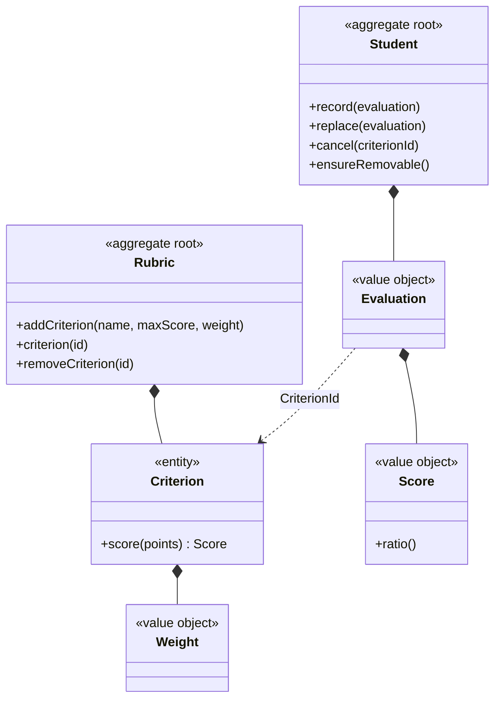
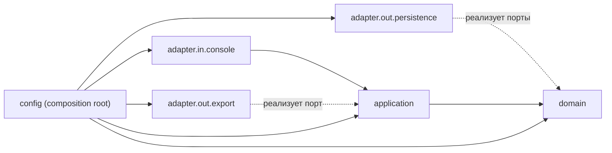

# ПОС - Преподавательская Оценка Студентов

Консольный модуль оценивания: студенты, рубрикатор критериев, оценки, итог по весам, аналитика и выгрузка итогов в CSV. Домен построен по DDD, архитектура - Ports and Adapters (Hexagonal), граф зависимостей собирает DI-контейнер Spring.

---

## Запуск

Нужен JDK 21 или новее (проверено на JDK 25). Все команды выполняются **из корня репозитория** - там, где лежат `gradlew` и `settings.gradle.kts`; модуль подключён строкой `include("modules:second_homework")`.

| Что | Команда |
|---|---|
| Сборка со всеми проверками (компиляция, Checkstyle, тесты, покрытие ≥ 60 %) | `./gradlew :modules:second_homework:build` |
| Интерактивное меню | `./gradlew :modules:second_homework:run --console=plain -q` |
| Сквозная демонстрация без ввода | `./gradlew :modules:second_homework:run --args="--demo" --console=plain -q` |
| Только тесты | `./gradlew :modules:second_homework:test` |

В Windows вместо `./gradlew` - `gradlew.bat`. Флаг `--console=plain` убирает индикатор прогресса Gradle, который иначе перемешивается с меню, а `-q` скрывает служебный вывод Gradle. Ввод в меню работает, потому что задача `run` передаёт приложению стандартный ввод (`standardInput = System.in` в `build.gradle.kts`).

Запуск без Gradle - готовым скриптом:

```bash
./gradlew :modules:second_homework:installDist
modules/second_homework/build/install/second_homework/bin/second_homework          # меню
modules/second_homework/build/install/second_homework/bin/second_homework --demo   # демонстрация
```

В Windows скрипт называется `second_homework.bat`.

**Куда пишется CSV.** При запуске через `run` - в `modules/second_homework/build/exports/`. При запуске скриптом - в каталог `exports` относительно текущего; другой каталог задаётся свойством `pos.export.dir`, например `JAVA_OPTS="-Dpos.export.dir=/tmp/pos"`. Полный путь к файлу приложение печатает после выгрузки.

**Отчёты после сборки** (внутри `modules/second_homework/build/reports/`): тесты - `tests/test/index.html`, покрытие - `jacoco/test/html/index.html`, Checkstyle - `checkstyle/main.html` и `checkstyle/test.html`.

---

## Меню

```
Студенты:
   1. Добавить студента
   2. Список студентов
   3. Удалить студента
Рубрикатор:
   4. Добавить критерий
   5. Показать рубрикатор
   6. Удалить критерий
Оценки:
   7. Выставить оценку
   8. Исправить оценку
   9. Отменить оценку
  10. Оценки студента
Итоги:
  11. Итог студента
  12. Итоговая ведомость и аналитика
  13. Экспорт итогов в CSV
Прочее:
  14. Демонстрация сквозного сценария
   0. Выход
```

Пункт 14 и флаг `--demo` прогоняют сквозной сценарий из ТЗ: завести студентов и критерии → выставить оценки → исправить и отменить → получить итог по двум правилам с аналитикой → выгрузить итог в CSV. Попутно каждое правило модели демонстрируется попыткой его нарушить («12 из 10», критерий не из рубрикатора, вторая оценка по критерию, повторная отмена, удаление студента с оценками и т. д.). Демонстрация работает с тем же курсом, что и меню, и безопасно запускается повторно: критерии с демонстрационными названиями переиспользуются.

Числа можно вводить и с запятой, и с точкой (`0,3` = `0.3`). Студентов, критерии и оценки выбирают из пронумерованного списка; при неверном формате консоль переспрашивает, а нарушение правил модели показывает сообщением и возвращает в меню.

---

## Язык предметной области

Слова из ТЗ - это имена типов в коде.

|Термин|Тип|Смысл|
|---|---|---|
|студент|`domain.student.Student`|кого оценивают|
|критерий|`domain.rubric.Criterion`|за что ставят балл: название, максимум, вес|
|рубрикатор|`domain.rubric.Rubric`|набор критериев курса|
|балл|`domain.rubric.Score`|«7 из 10» - число вместе с максимумом критерия|
|вес|`domain.rubric.Weight`|вклад критерия в итог|
|оценка|`domain.student.Evaluation`|«этому студенту по этому критерию поставили такой балл», с датой и комментарием|
|строка ведомости|`domain.grading.GradeLine`|критерий и оценка по нему, если есть|
|итог|`domain.grading.FinalGrade`|результат по студенту из его оценок и рубрикатора|
|правило итога|`domain.grading.GradingPolicy`|как свести строки ведомости в итог|
|текущая успеваемость|`domain.grading.GradedOnlyPolicy`|итог только по выставленным оценкам|
|итоговая ведомость|`application.GradeSheet`|итоги всех студентов и аналитика|

---

## Карта DDD

### Агрегаты и их границы



- **Рубрикатор** (`Rubric`) - корень, критерии (`Criterion`) - сущности внутри. Критерий нельзя создать в обход рубрикатора (конструктор закрыт от других пакетов), поэтому рубрикатор гарантирует уникальность названий (без учёта регистра) и сквозную нумерацию, которая не переиспользуется после удаления.
- **Студент** (`Student`) - корень, его оценки (`Evaluation`) - внутри агрегата. Главное правило оценок касается одного студента: по каждому критерию не больше одной оценки. Выставить, исправить и отменить оценку можно только через корень, поэтому правило нельзя обойти.
- Агрегаты ссылаются друг на друга **только по идентификатору**: оценка хранит `CriterionId`, а не объект критерия.

### Entity и Value Object

**Сущность - `Student`.** Два студента «Анна Смирнова» - разные люди; студент остаётся тем же, когда меняются его оценки. Поэтому равенство - по номеру `StudentId` (`StudentTest.equalityById`). Так же устроен `Criterion`.

**Объект-значение - `Score`.** «7 из 10» равно любому другому «7 из 10», своей идентичности у балла нет. Он неизменяем и проверяет себя сам: «12 из 10» нельзя создать (`ScoreTest`). Вместе с баллом хранится максимум - поэтому балл сравним между критериями через долю `ratio()`. Другие объекты-значения: `Weight` (нормализуется: `0.30` и `0.3` - один вес), `StudentId`, `CriterionId`, `FinalGrade`.

**`Evaluation` - тоже объект-значение**, хотя её можно «исправить». У оценки нет собственной жизни вне студента, а исправление по смыслу - замена прежней оценки новой; история изменений не требуется. Поэтому класс неизменяем, равенство - по всем полям, а `Student.replace` подменяет значение.

### Инварианты

|Правило|Где охраняется|Тест|
|---|---|---|
|балл в пределах критерия (`0 ≤ балл ≤ максимум`)|`Score` (конструктор), создаётся через `Criterion.score`|`ScoreTest`, `EvaluationFactoryTest.rejectsScoreOutOfCriterionBounds`|
|оценка только по критерию из рубрикатора|`EvaluationFactory` → `Rubric.criterion`|`EvaluationFactoryTest.rejectsUnknownCriterion`|
|по критерию не больше одной оценки|`Student.record`|`StudentTest.Record.rejectsSecondEvaluation`|
|исправить и отменить можно только существующую оценку|`Student.replace`, `Student.cancel`|`StudentTest.CorrectAndCancel`|
|исправленная оценка проходит те же проверки|`GradingService.correct` создаёт её той же фабрикой|`GradingServiceTest.correctionIsValidated`|
|итог согласован с текущим набором оценок|итог не хранится, а считается `FinalGradeCalculator` при каждом запросе|`FinalGradeCalculatorTest.Consistency`|
|названия критериев уникальны|`Rubric.addCriterion`|`RubricTest.AddCriterion.rejectsDuplicateName`|
|максимум критерия 1–100, вес в $(0; 100]$|`Score.requireValidMax`, `Weight`|`ScoreTest`, `WeightTest`|
|нельзя удалить студента или критерий с оценками|`Student.ensureRemovable`; для критерия - сценарий `CourseSetupService.removeCriterion` (затрагивает всех студентов)|`CourseSetupServiceTest`|
|непустые ФИО и названия разумной длины|`domain.shared.Texts`|`TextsTest`|

Максимум и вес критерия после создания не меняются: правка максимума задним числом сделала бы уже выставленные оценки некорректными.

### Repository

Порты лежат в домене рядом со своими агрегатами - `domain.student.StudentRepository` и `domain.rubric.RubricRepository`; реализации - адаптеры `adapter.out.persistence.InMemory*`. Номер нового студента выдаёт хранилище (`nextId()`), потому что только оно знает, какие номера заняты. Метод по умолчанию `StudentRepository.get` превращает «не нашли» в `UnknownStudentException` одинаково для любой реализации.

### Domain Service

`domain.grading.FinalGradeCalculator` - расчёт итога. Правило не принадлежит ни одному агрегату: веса и максимумы живут в рубрикаторе, оценки - у студента. Сервис соединяет их в строки ведомости (`GradeLine`) и передаёт выбранному правилу итога. Состояния у него нет, итог нигде не сохраняется - поэтому он всегда согласован с текущими оценками: исправили или отменили оценку, и следующий расчёт это учтёт.

Формула обоих правил - взвешенное среднее долей по десятибалльной шкале:

$$\text{итог} = 10 \cdot \frac{\sum_i w_i \cdot p_i / m_i}{\sum_i w_i},$$

где $w_i$ - вес критерия, $p_i$ - балл, $m_i$ - максимум. Веса нормируются на сумму, поэтому их можно задавать и долями (0,3), и процентами (30), и сумма не обязана быть равна 1 - иначе рубрикатор нельзя было бы собирать по одному критерию. Пример из демонстрации: $10 \cdot (0{,}3 \cdot \tfrac{9}{10} + 0{,}3 \cdot \tfrac{18}{20} + 0{,}4 \cdot \tfrac{85}{100}) = 8{,}8 \to 9$.

---

## Архитектура: Ports and Adapters

```
src/main/java
├── app/Main                      точка входа: поднимает контейнер, запускает меню или демо
├── config/AppConfig              composition root: весь граф и выбор адаптеров
├── domain/                       ядро: не зависит ни от чего, кроме JDK
│   ├── shared/                   общее правило текстовых полей
│   ├── rubric/                   Rubric, Criterion, Score, Weight, CriterionId, RubricRepository (порт)
│   ├── student/                  Student, Evaluation, EvaluationFactory, StudentId, StudentRepository (порт)
│   ├── grading/                  FinalGradeCalculator, GradingPolicy и реализации, RoundedPolicy, FinalGrade, GradeLine
│   └── exception/                иерархия исключений модели
├── application/                  сценарии: CourseSetupService, GradingService, FinalGradeService;
│                                 проекции StudentView, StudentCard, StudentGrade, GradeSheet;
│                                 выходной порт GradeSheetExporter
└── adapter/
    ├── in/console/               входной адаптер: меню, ввод, вывод, демонстрация
    ├── out/persistence/          выходной адаптер: хранилища в памяти
    └── out/export/               выходной адаптер: CSV-файл
```



**Стрелка зависимостей: `adapter → application → domain`; `config` знает всех, его не знает никто.** Домен не знает ни про консоль, ни про файлы, ни про Spring; слой приложения не знает про CSV и консоль - только про порт `GradeSheetExporter`. Правило проверяет тест `architecture.ArchitectureTest`: он разбирает импорты исходников и падает, если домен импортирует `application`, `adapter`, `config`, Spring, `java.io` или `java.nio`, а слой приложения - адаптеры, Spring или файловый ввод-вывод. Lombok в домене - только аннотации времени компиляции (`compileOnly`), в рантайме его нет.

**Порты:**

- *входной* - публичные методы трёх сервисов приложения. Отдельный интерфейс над единственной реализацией был бы декоративным: подменять сценарии некем;
- *выходные* - `StudentRepository`, `RubricRepository` (домен), `GradeSheetExporter` (приложение) и `java.time.Clock` - стандартная абстракция часов, свою вводить незачем.

**Что отдаёт слой приложения.** Только неизменяемые значения: доменные объекты-значения как есть (`Evaluation`, `FinalGrade`, `GradeLine`, `Criterion` без изменяющих методов), а вместо изменяемого агрегата `Student` - проекции `StudentView`, `StudentCard`, `StudentGrade`. Поэтому консоль не может выставить оценку в обход сценария и забыть сохранить студента.

**Сценарий изменения** везде одинаков: загрузить агрегаты из хранилищ → вызвать поведение модели → сохранить. Хранилище в памяти возвращает тот же объект, но сервисы всё равно вызывают `save` - это контракт порта для настоящего хранилища (файл, БД), которое можно подключить без правки сервисов.

---

## Паттерны GoF

По одному паттерну из каждой группы - там, где без него была бы конкретная боль.

|Группа|Паттерн|Где|Какую боль закрывает|
|---|---|---|---|
|порождающий|**Фабрика**|`domain.student.EvaluationFactory`|Оценке для создания нужно то, чего у неё нет: рубрикатор (критерий должен существовать), максимум критерия (балл в пределах) и текущая дата. Фабрика - единственный способ создать оценку (конструктор `Evaluation` закрыт), поэтому «12 из 10» и оценку по несуществующему критерию создать нельзя ни из меню, ни из демо, ни при исправлении. Дата берётся из `Clock`, и в тестах она предсказуема.|
|структурный|**Декоратор**|`domain.grading.RoundedPolicy`|Округление не зависит от того, как итог посчитан. Без декоратора его пришлось бы повторять в каждом правиле итога или делать в консоли и экспорте - то есть размазать по UI. Декоратор надевается один раз в `AppConfig.gradingPolicies()` с разной точностью: официальный итог - до целого по шкале ВШЭ, текущая успеваемость - до сотых.|
|поведенческий|**Стратегия**|`domain.grading.GradingPolicy`: `FullRubricPolicy`, `GradedOnlyPolicy`|Правило свёртки оценок в итог - решение курса, а не калькулятора, и их нужно минимум два: в конце курса невыставленная оценка - это 0, а в середине модуля нужна текущая успеваемость, иначе ещё не сданный экзамен даёт всем «неуд». Пользователь выбирает правило при каждом запросе итога; новое правило (например, «отбросить худшую ДЗ») - новый класс, калькулятор и консоль не меняются.|

**Сознательно не применены:** Builder для рубрикатора (рубрикатор собирается по одному критерию из меню - строитель здесь был бы для галочки), Facade (у трёх сервисов разные зоны ответственности, фасад над ними был бы сервисом-проходником), Template Method для экспорта (формат один), Command для пунктов меню (см. ниже про OCP).

---

## DI-контейнер

Используется только `spring-context` (`AnnotationConfigApplicationContext`) - без Spring Boot и без сканирования компонентов.

- **Бины объявлены явно в `config.AppConfig`.** Классы приложения не помечены аннотациями Spring: домен и сценарии не зависят от фреймворка, а весь граф виден в одном файле.
- **Порты объявлены типом интерфейса** (`StudentRepository`, `RubricRepository`, `GradeSheetExporter`, `Clock`): остальной граф знает только абстракцию, и подменяется именно она.
- **`@Configuration(proxyBeanMethods = false)`.** Зависимости приходят параметрами `@Bean`-методов, поэтому подмена бина через `@Primary` работает без прокси.
- **Все бины - синглтоны.** Для хранилищ это критично: второй экземпляр разделил бы курс надвое (`AppConfigTest.servicesShareRepositories`).
- **Подмена в тестах через контейнер** - `config.DependencyOverrideTest`: контекст собирается из настоящего `AppConfig` и тестовой конфигурации с бинами `@Primary` - фиксированные часы и выгрузка в память. Тест проверяет, что дата оценки взята из подменных часов, а экспорт ушёл в подменный порт, хотя ни сервисы, ни `AppConfig` о подмене не знают.

---

## Исключения

```
RuntimeException
├── PosException                              (abstract) корень проекта
│   ├── InvalidValueException                 (abstract) значение нарушает инвариант
│   │   ├── InvalidTextException              пустое или длинное ФИО, название, комментарий
│   │   ├── InvalidIdentifierException        номер ≤ 0
│   │   ├── InvalidScoreException             «12 из 10»
│   │   ├── InvalidMaxScoreException          максимум критерия вне 1–100
│   │   └── InvalidWeightException            вес вне (0; 100]
│   ├── UnknownCriterionException             критерия нет в рубрикаторе
│   ├── UnknownStudentException
│   ├── DuplicateCriterionException           название критерия занято
│   ├── DuplicateEvaluationException          по критерию уже есть оценка
│   ├── MissingEvaluationException            исправлять или отменять нечего
│   ├── EmptyRubricException                  итог не из чего считать
│   ├── RemovalBlockedException               у студента или критерия есть оценки
│   ├── application.UnknownPolicyException    нет правила итога с таким кодом
│   └── application.ExportFailedException     ошибка файловой системы при выгрузке
├── adapter.in.console.InputClosedException   сигнал «ввод закончился»
└── adapter.in.console.NothingToChooseException  подсказка «сначала добавьте студента»
```

- Консоль перехватывает `PosException` одним обработчиком на уровне пункта меню и показывает сообщение; любое другое исключение означает ошибку в коде и не скрывается.
- Ошибки сценария выгрузки объявлены в слое приложения рядом с портом: адаптер переводит в них `IOException` и недопустимое имя файла (`InvalidPathException`), поэтому неудачная выгрузка не роняет приложение.
- Два исключения консоли сознательно вне иерархии: это не ошибки данных, а управление диалогом.
- Нарушения, которые означают ошибку в коде, а не в данных (итог вне шкалы, оценка в строке чужого критерия, неверная конфигурация правил), - стандартные `IllegalArgumentException`; `null` в аргументах - `NullPointerException` (Lombok `@NonNull`).

---

## Тесты

130 тестовых методов, 195 запусков с учётом параметризованных. Структура зеркалит пакеты приложения; общая инфраструктура - в `support`:

|В `support`|Назначение|
|---|---|
|`TestData`|Object Mother: рубрикатор из трёх критериев с разными максимумами, фиксированные часы, студенты с оценками|
|`CourseFixture`|собранный курс поверх свежих хранилищ с подменной выгрузкой|
|`RecordingExporter`|fake порта выгрузки: ничего не пишет на диск, запоминает вызовы|
|`TestPolicies`|правила как в конфигурации и правило-заглушка для проверки стратегии|
|`TestConsole`|ввод из строк, вывод в буфер|

Что фиксируют тесты:

- **инварианты модели** - `domain.*`: границы балла и максимума, нормализация веса, уникальность критериев, одна оценка на критерий, исправление и отмена, связь оценки с рубрикатором;
- **доменный сервис** - `FinalGradeCalculatorTest`: формула на примере, нормировка весов (доли и проценты дают один итог), подмена стратегии заглушкой, согласованность итога после исправления и отмены;
- **паттерны** - `GradingPoliciesTest` (две стратегии на одних данных, таблица округления декоратора), `EvaluationFactoryTest`;
- **сценарии** - `application.*`, включая аналитику ведомости и прохождение экспорта через порт;
- **адаптеры** - CSV (BOM, экранирование по RFC 4180, ошибки файловой системы), консоль (сценарии меню строками ввода), сквозная демонстрация и её повторный запуск;
- **архитектура и DI** - `ArchitectureTest`, `AppConfigTest`, `DependencyOverrideTest`.

**Покрытие (JaCoCo):** строки - 97,7 %, ветвления - 74,5 %. Основная часть непокрытых ветвлений - проверки `null`, которые генерирует Lombok `@NonNull`. Код, полностью сгенерированный Lombok, помечается `@Generated` (`lombok.config`) и в покрытие не входит. Сборка падает, если покрытие строк ниже 60 %.

---

## Code style

Код проверяется Checkstyle 14.1.0 при каждой сборке, и сборка падает на первом же нарушении (`maxWarnings = 0`). **Конфигурация лежит в модуле**: `config/checkstyle/checkstyle.xml` и `suppressions.xml` рядом с ней. Основа - `sun_checks.xml` из того же Checkstyle; отличия описаны в начале файла и отмечены комментариями `ПОС:`:

- длина строки - 100 символов вместо 80;
- отключено `FinalParameters`; `HiddenField` не проверяет параметры конструкторов;
- кодировка исходников - UTF-8 явно;
- в тестах не требуются Javadoc полей и пакетов, разрешены числа в данных тестов.

Javadoc - у всех публичных типов и методов, `package-info.java` - у каждого пакета.

---

## Сознательные упрощения и ограничения OCP

- **OCP в меню ограничен сознательно.** Новый пункт меню требует правки `switch` в `ConsoleApp.handle` и текста меню в `ConsolePrinter`. «Команда» для полутора десятков пунктов была бы overengineering, а консоль - самое дешёвое для правки место. Главные точки расширения от этого не зависят: новое правило итога добавляется в `AppConfig.gradingPolicies()`, и меню само предлагает его.
- **Хранилище в памяти:** данные живут, пока работает приложение. Переход на файл или БД - новый адаптер портов `StudentRepository` и `RubricRepository`.
- **Один курс - один рубрикатор.** С несколькими курсами рубрикатор и студент получат номер курса; правила модели останутся прежними.
- **Изменение критерия** (максимума и веса) не поддерживается, удаление студента и критерия разрешено только без оценок - чтобы итоги не менялись молча.
- **Однопоточность:** хранилища не синхронизированы - консольное приложение однопоточное.

---

## Роль ИИ

Использовался Claude, Opus 5.5 (Anthropic).

**Что сделал ИИ:**

- Оказал содействие при проектировке модели и архитектуры;
- Добавил большее число тестов на основе написанных;
- Написал основную часть реализаций методов;
- Помог в исправлении ошибок (при проектировке, реализации, написании тестов и т.д.);
- Написал комментарии и документацию;
- Помог с настройкой инструментария Java: Gradle, Checkstyle и JaCoCo;
- Сделал более красивый вывод;
- Написал по предложенному плану README.

**Что сделал я:**

- Задал общую структуру проекта;
- Спроектировал первоначальную архитектуру приложения с учётом требований задания;
- Внёс значительные изменения и улучшения в первоначальную архитектуру путём обсуждения проекта с ИИ;
- Проанализировал все предложенные ИИ архитектурные решения и реализации. Многие предложения ИИ были отвергнуты или переработаны;
- Написал реализации отдельных методов;
- Написал первоначальные тесты (на каждый из модулей по небольшому числу собственноручно);
- Создал общий план для README с описанием каждого необходимого пункта.